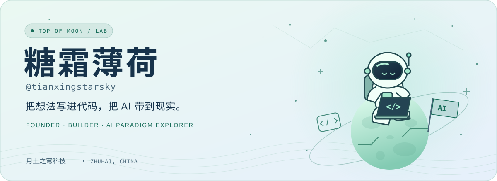
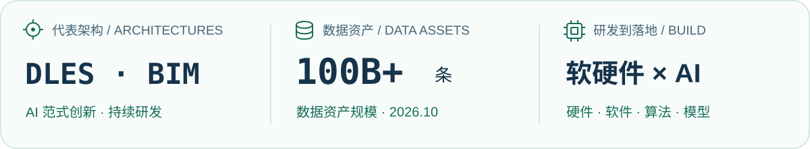
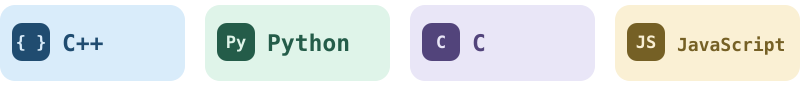

<picture>
  <source media="(prefers-color-scheme: dark)" srcset="assets/hero-dark.svg">
  <source media="(prefers-color-scheme: light)" srcset="assets/hero-light.svg">
  
</picture>

<p align="center">
  <i>A Founder's Notes on Building Intelligence</i><br>
  <a href="https://github.com/tianxingstarsky">tianxingstarsky</a> · <a href="https://www.topofmoon.com/">Top of Moon</a> · Zhuhai, China
</p>

## Abstract, More or Less

Hi, I'm **tianxingstarsky** — an entrepreneur who keeps turning *“what if?”* into things that compile.

I founded **Top of Moon** (珠海市月上之穹科技有限公司), an independently owned AI technology company in **Zhuhai, China**. Our work spans **hardware, software, algorithms, model training, and R&D**, with a focus on **AI paradigm innovation**.

The scope is broad. The loop is simple: **ask, build, measure, repeat**.

## Blueprints Are Also Hypotheses

**DLES** and the **BIM series** are representative architectures in our research. Alongside that exploration, we're building the data foundation for model training: **100B+ records in company data assets**, as of **October 2026**.

<picture>
  <source media="(max-width: 600px) and (prefers-color-scheme: dark)" srcset="assets/research-mobile-dark.svg">
  <source media="(max-width: 600px)" srcset="assets/research-mobile-light.svg">
  <source media="(prefers-color-scheme: dark)" srcset="assets/research-dark.svg">
  <source media="(prefers-color-scheme: light)" srcset="assets/research-light.svg">
  
</picture>

## Four Languages, Many Rabbit Holes

My usual toolkit: **C++ · Python · C · JavaScript**. The occasional rabbit hole comes with the territory.

<p align="center">
  <picture>
    <source media="(max-width: 600px)" srcset="assets/languages-mobile.svg">
    
  </picture>
</p>

```python
while curiosity:
    idea = ask("what if?")
    result = build_and_test(idea)
    # negative results count, too
    learn(result)
```

## Every Good Hypothesis Deserves a Repository

**[ShuJian Cube: Turning Context into Training Data](https://github.com/tianxingstarsky/Super-LLM-distill-Gen)**<br>
Documents, agent conversations, and creative briefs become training examples through a visual workflow, human review, and export.

**[OpenMyModel: Local Models, Wider Orbits](https://github.com/tianxingstarsky/OpenMyModel)**<br>
Connect local inference to your own cloud gateway, with an OpenAI-compatible API, multi-node model routing, and usage metering.

**[ConvMambaTF-LLM: On Convolutions, Memory, and Attention](https://github.com/tianxingstarsky/ConvMambaTF-LLM)**<br>
A hybrid architecture experiment bringing convolutional embeddings, Mamba2, and Transformer together. Training workflows, ablations, and comparison results included — even the plot twists.

<details>
  <summary><b>Appendix A: One Small Commit</b></summary>

```text
$ cat lunar-desk.log
founder:      on Earth
ideas:        in orbit
experiments:  in progress

$ git commit -m "one small step for a prototype"
🌙 Next hypothesis, please.
```

</details>

---

<p align="center">
  <b>Interesting problems travel well.</b><br>
  For AI research and hardware/software collaborations, find me through the <a href="https://www.topofmoon.com/">company website</a>.<br>
  For open source, meet me in the relevant repository.<br><br>
  <sub>Built in Zhuhai. Revised whenever curiosity wins.</sub>
</p>
